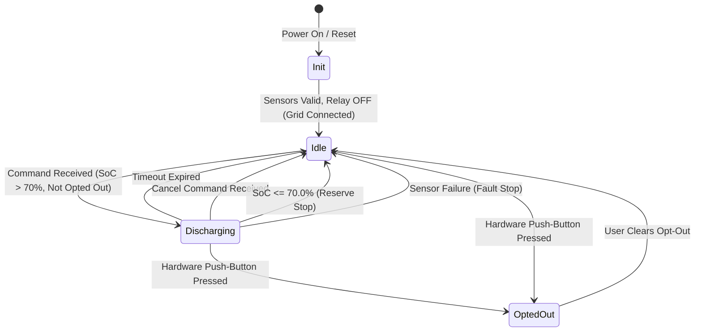

# Application Flow & State Machine — SAANJH

**Project:** SAANJH  
**Scope:** Gateway Service Loop, Node Firmware State Machine, and Disaster Recovery Transitions  

---

## 1. Node Firmware State Machine (`node_controller.cpp`)

## 2. Gateway Event Dispatch Loop (`gateway/service.py`)
1. **Tick (10 s):** Ingest LoRa radio packets; decode Telemetry and ACK frames.
2. **Process Image Update:** Update Node Registry with voltage, current, SoC, and status flags.
3. **Safety Gate:** Verify node freshness ($<30\text{ s}$) and SoC ($>70\%$). Cancel any expired commands ($>90\text{ s}$).
4. **Dispatch Tick (15 min):** Evaluate DT grid power against allocation. If deficit occurs, execute 4-step dispatch ladder.
5. **Command Emission:** Transmit LoRa command frames to targeted node IDs; monitor ACKs.
6. **Time-Series Persistence:** Write telemetry, commands, ACKs, and dispatch decisions to SQLite3 and CSV logfiles.
7. **Atomic State Publishing:** Atomically write `live_summary.json` for dashboard visualization.
