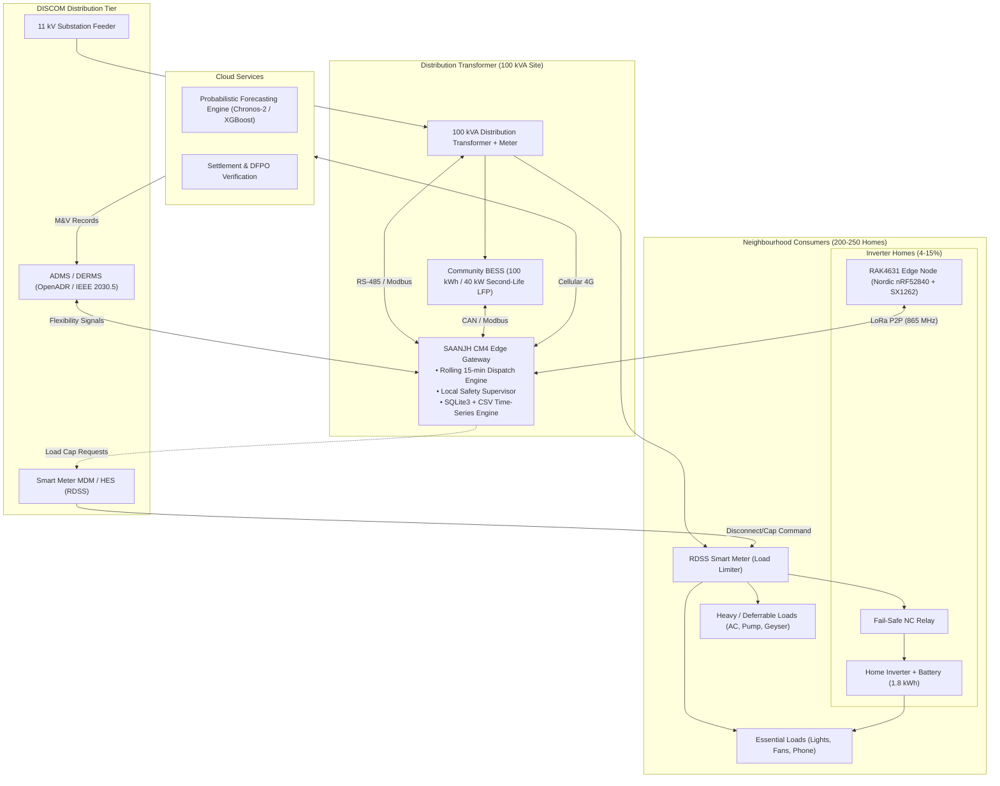

# System Architecture & Topology — SAANJH

**Project:** SAANJH  
**Scope:** Energy, Data, Protocol, and Financial Mesh  

---

## 1. End-to-End System Mesh

## 2. Dispatch Priority Ladder (15-min Intervals)
1. **Rebound & Inertial Flexibility:** Suppress appliance rebound.
2. **Inverter Relay Borrowing:** Energize NC relay on home inverters (SoC > 70%), least-utilized homes first.
3. **Appliance Deferral:** Shift water heaters, pumps, AC setpoints.
4. **Community BESS Full Support:** Discharge community BESS if capacity covers total anticipated deficit.
5. **Essential Band Load Limiting:** Remote smart meter cap: 1000 W $\rightarrow$ 750 W $\rightarrow$ 500 W.
6. **Community BESS Reserve Injection:** Defend the 500 W essential floor with reserve energy.
7. **Fair Rotational Disconnect:** Disconnect single homes with least cumulative annual outage; critical loads last.
