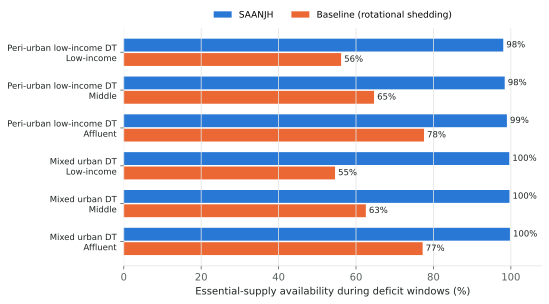
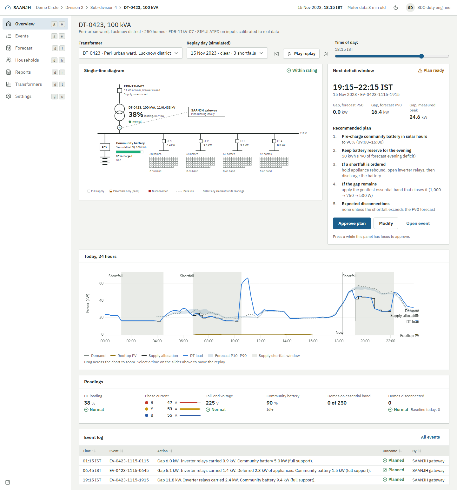

# SAANJH

When a state runs short of power in the evening, DISCOMs switch off whole feeders in
rotation and every home on them loses everything. SAANJH keeps every home's essentials
(lights, fans, fridge, phone charging) on instead. It caps heavy loads through the
smart meters DISCOMs are already installing, shares a second-life community battery at
the distribution transformer, borrows a little from homes that own inverters, and plans
each evening with a probabilistic forecast. Built for the Schneider Electric Yuva Yodha
2026 hackathon, track "Grid Reliability & Renewable Intermittency".

<!-- results:headline:start -->
On the simulated peri-urban low-income DT (250 homes), homes kept their essential supply during 98% of supply-shortfall time with SAANJH, against 59% under today's rotational load shedding, and full disconnection fell from 240 to 10.8 hours per home per year (mean of 30 Monte Carlo runs). On the simulated mixed urban DT (200 homes), homes kept their essential supply during 100% of supply-shortfall time with SAANJH, against 62% under today's rotational load shedding, and full disconnection fell from 78 to 0.7 hours per home per year (mean of 30 Monte Carlo runs). Most of the gain comes from the shared community battery: without it, essential-supply availability is 76% on the peri-urban low-income DT and 82% on the mixed urban DT.
<!-- results:headline:end -->

**Interactive console:** run `streamlit run dashboard/app.py` after the quick start below. It covers the reliability scorecard, the energy reconciliation, low-income economics, overload and communication robustness, Indian calibration, the hardware-in-the-loop gateway log and the DISCOM dispatch decisions.

## Results

<!-- results:readme_results:start -->
*SIMULATED on inputs calibrated to real data. Mean of 30 Monte Carlo runs over one year (Lucknow 2023 weather). Full tables, ranges and sensitivity: [docs/WRITEUP.md](docs/WRITEUP.md).*

| Metric | Peri-urban low-income DT: baseline → SAANJH | Mixed urban DT: baseline → SAANJH |
|---|---:|---:|
| Essential-supply availability in deficit windows | 59% → 98% | 62% → 100% |
| Outage hours per home per year | 240.3 → 10.8 | 78.0 → 0.7 |
| Energy not served (kWh/year) | 11,457 → 527 | 3,019 → 36 |
| Hours on essential band per home per year | 0.0 → 1.2 | 0.0 → 0.2 |
| Net cost per home per month (DISCOM-owned) | Rs 103 | Rs 138 |
| Cost per household-hour of essential supply preserved | Rs 9 | Rs 35 |
<!-- results:readme_results:end -->





## Quick start

Python 3.11 or 3.12. From a fresh clone:

```bash
python -m venv .venv
# Windows: .venv\Scripts\activate    Linux/macOS: source .venv/bin/activate
pip install -r requirements.txt

python scripts/run_all.py --quick        # contracts, replay evidence, docs check, tests
streamlit run dashboard/app.py           # evidence console at http://localhost:8501
```

`run_all.py --quick` validates every result bundle, regenerates the six-hour
hardware-in-the-loop replay, re-validates it, checks that the docs match
`results.json`, and runs the test suite. The expected result is **90 passed**.

The React console remains available as a secondary UI:

```bash
cd ui && npm install && npm run dev      # http://localhost:5173
```

To regenerate everything from scratch (about an hour on a 32-core machine):

```bash
python simulation/run_year.py            # year-long Monte Carlo + sensitivity
python ai_forecasting/evaluate.py        # forecasts (Chronos-2 on CPU) and decision value
python simulation/economics_engine.py    # unit economics and ownership models
python scripts/make_figures.py && python scripts/make_diagrams.py
python backend/export.py                 # replay data for the API and the UI
python scripts/render_results.py         # fills every results table in the docs
uvicorn backend.main:app --port 8000     # optional API (the UI also runs on the static bundle)
```

## Hardware prototype (Phase 1)

The repository includes a working ≤12 V DC bench prototype, not just a
simulation:

* **Three RAK4631 nodes** (nRF52840 + SX1262) with a LiFePO4 pack, an INA226
  current sensor, a 12 V dummy load and a fail-safe relay. Telemetry every 10 s
  over LoRa P2P at 865.0625 MHz; commands acknowledged; the node refuses to
  discharge at or below **70% SoC** and on push-button opt-out.
* **A CM4 + SX1262 gateway** that logs telemetry, commands, ACKs, dispatch and
  grid samples to CSV and SQLite, serves the Streamlit console, and replays a
  154 kW feeder stress profile.
* **Fail-safe by construction:** the relay's normally-closed contact is the grid
  path, so reset, brown-out, fault or opt-out all return the load to grid.

| Document | What it covers |
|---|---|
| [`docs/HARDWARE.md`](docs/HARDWARE.md) | Pin maps, wiring, radio settings, bench checklist |
| [`docs/BOM.md`](docs/BOM.md) | Prototype bill of materials with rough prices |
| [`docs/DEMO.md`](docs/DEMO.md) | Five-minute demo script, live and replay |
| [`docs/LIMITATIONS.md`](docs/LIMITATIONS.md) | What is tested, modelled, or still bench-pending |
| [`firmware/rak4631_node/README.md`](firmware/rak4631_node/README.md) | Firmware build, flash and test |

Build and test the firmware:

```bash
cd firmware/rak4631_node
pio run -e node101 -e node102 -e node103   # three node images
pio test -e native                         # 34 protocol/controller/battery tests
```

At the time of writing there is **no live hardware evidence committed**. The
gateway summary is a seeded replay and the dashboard labels it as such. The
bench validation table in `docs/HARDWARE.md` is the gap to close before the
Prototype Phase submission.

## Repository map

| Path | What it is |
|---|---|
| `docs/WRITEUP.md` | The submission write-up |
| `docs/PROJECT_BRIEF.md` | Facts, sources and ground rules every change follows |
| `docs/HARDWARE.md` | Prototype pin maps, wiring, radio config and bench checklist |
| `docs/BOM.md` | Prototype bill of materials with rough prices |
| `docs/DEMO.md` | Five-minute demo script and failure recovery |
| `docs/LIMITATIONS.md` | Evidence status and honest limits |
| `docs/SUBMISSION_CHECKLIST.md` | Prototype Phase deliverables and acceptance gates |
| `docs/DATA_SOURCES.md` | Every dataset, its licence and its REAL / CALIBRATED / SIMULATED label |
| `docs/OWNERSHIP_MODEL.md` | Ownership, O&M and unit economics |
| `docs/SERVICE_BLUEPRINT.md` | Service blueprint, enrolment to complaints |
| `docs/architecture/` | Architecture, event sequence, failure modes, data model, money flows (Mermaid + SVG) |
| `docs/REVIEW_FINDINGS.md` | Hostile-reviewer pass |
| `simulation/` | Household fleet, mechanisms, dispatcher, year-long engine, metrics, economics |
| `simulation/contracts.py` | Pydantic result and protocol contracts; exports `schemas/` |
| `schemas/` | JSON Schema for every result bundle and protocol frame |
| `dashboard/` | Streamlit evidence console: seven tabs, robust loaders, headless tests |
| `gateway/` | CM4 gateway: LoRa drivers, protocol, dispatcher, safety, replay/live service |
| `firmware/rak4631_node/` | RAK4631 firmware, native Unity tests and PlatformIO environments |
| `scripts/run_all.py` | One-command regeneration and verification |
| `ai_forecasting/` | Day-ahead probabilistic forecasting and its evaluation |
| `data/` | Download and processing scripts; processed NASA POWER weather |
| `config/` | All parameters with source or ASSUMPTION labels |
| `backend/` | FastAPI replay service and the data exporter |
| `ui/` | React operator console, field app, household messages, design system |
| `tests/` | pytest suite |
| `frontend/` | FUXA SCADA/HMI platform (MIT, see `docs/OPEN_SOURCE_NOTICES.md`) and the SAANJH tag adapter; legacy, not on the critical path |
| `archive/` | Earlier Blender renders, demo and walkthrough videos (including the 5-minute submission video) and video scripts |

## Data sources

NASA POWER (weather, real data), Prayas eMARC (household load calibration), Prayas ESMI
(outage calibration) and the UCI household dataset (non-Indian forecasting benchmark
only). Details and limitations: [docs/DATA_SOURCES.md](docs/DATA_SOURCES.md).

## What this does and does not prove

The control logic and safety interlocks are tested: 90 Python tests and 34
native C++ tests, including the exact 70.0% reserve boundary and the fail-safe
relay state. The system-level benefit is **simulated** on inputs calibrated to
NASA POWER, Prayas eMARC and Prayas ESMI. The hardware is a **≤12 V DC bench
prototype**, not a field installation, and its committed gateway evidence is a
seeded replay rather than a radio measurement.

The energy claim has also been corrected downward: the legacy 45-minute case
claimed 42.19 kWh, while the audited reconciliation delivers 7.22 kWh and
reports 34.97 kWh unmet. The annual result does not depend on the legacy number.

Read [`docs/LIMITATIONS.md`](docs/LIMITATIONS.md) before quoting any number from
this repository.

## Licence

MIT. See [`LICENSE`](LICENSE) and [`docs/OPEN_SOURCE_NOTICES.md`](docs/OPEN_SOURCE_NOTICES.md).
Third-party data keeps its own licence (see [`docs/DATA_SOURCES.md`](docs/DATA_SOURCES.md)).
