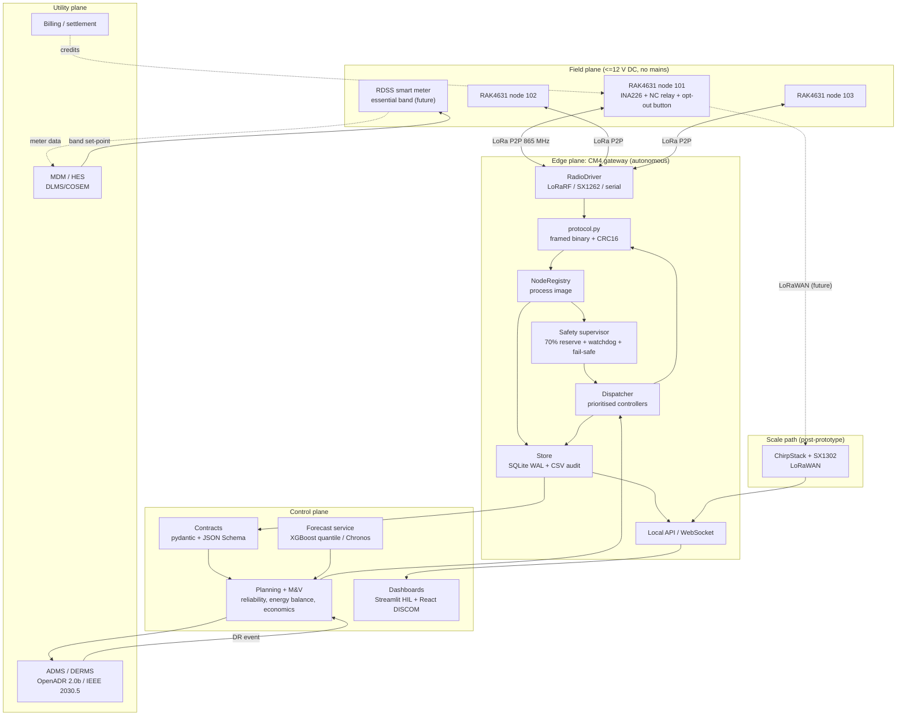

# Code reuse and target architecture

Research date: 14 November 2026. Scope: which public GitHub codebases SAANJH can
directly reuse, which ones are only architectural references, and what target
architecture follows from that. Repository metadata (stars, last push, licence)
was read from GitHub on the research date; star counts are a weak signal and are
shown only to indicate maturity.

The short answer:

- **Adopt six small libraries now**: RadioLib (node radio), LoRaRF-Python
  (gateway radio, optional fallback), pydantic + jsonschema (contracts), pvlib
  (PV calibration), pandapower (LV validation), and `scores` (forecast
  verification).
- **Borrow patterns, do not vendor platforms**: OpenEMS (process image,
  prioritised controllers, local autonomy), `virtual-power-plant` (dispatch
  orchestration, audit trail, control watchdog), FlexMeasures
  (forecast -> schedule -> validate loop).
- **Do not adopt**: OpenEMS, FlexMeasures, virtual-power-plant, ThingsBoard,
  Grafana, Home Assistant, evcc, Meshtastic, or a full LoRaWAN stack for the
  prototype. They either add a runtime SAANJH does not need, carry a licence
  that is awkward for a distributed product, or solve a different problem.
- **Keep LoRa P2P for the three-node prototype.** The Waveshare SX1262 HAT is a
  single-channel radio, not an SX130x concentrator. LoRaWAN + ChirpStack is the
  scale path, not the prototype path.

The architecture that follows is an **edge-autonomous, contract-first modular
monolith**, not a microservice platform. The CM4 gateway must keep running when
the cloud link is down, and the dashboard must read the same evidence the
gateway wrote.

---

## 1. Reuse decision table

Verdicts:

- **Adopt now** - add as a dependency or direct integration before 7 December.
- **Pilot** - useful, but only after the prototype evidence is locked.
- **Pattern only** - read the design, write our own small module, do not vendor.
- **Do not adopt** - wrong licence, wrong scale, or wrong problem.

| Repository | Licence | What it is | SAANJH use | Verdict | Integration point |
|---|---|---|---|---|---|
| [jgromes/RadioLib](https://github.com/jgromes/RadioLib) | MIT | Universal embedded radio library, active SX126x support | RAK4631 LoRa P2P firmware | **Adopt now** | `firmware/rak4631_node/platformio.ini`, `src/main.cpp` |
| [chandrawi/LoRaRF-Python](https://github.com/chandrawi/LoRaRF-Python) | MIT | Linux SPI driver for SX126x/SX127x, used by the Waveshare sample | CM4 gateway SX1262 SPI transport | **Adopt now (optional)** | `gateway/lora_driver.py` as `LoRaRfDriver`; keep the existing driver as fallback |
| [RAKWireless/RAK-nRF52-Arduino](https://github.com/RAKWireless/RAK-nRF52-Arduino) | LGPL-2.1 | Arduino BSP for RAK4631 (nRF52840) | Build toolchain only | **Adopt as build dependency** | PlatformIO board definition; keep notice, do not modify BSP |
| [pydantic/pydantic](https://github.com/pydantic/pydantic) | MIT | Data validation for Python | Packet, dispatch and result contracts | **Adopt now** | `simulation/contracts.py`, gateway summaries, CI |
| [python-jsonschema/jsonschema](https://github.com/python-jsonschema/jsonschema) | MIT | JSON Schema validation | Validate committed result JSONs | **Adopt now** | `schemas/`, `tests/test_contracts.py` |
| [pvlib/pvlib-python](https://github.com/pvlib/pvlib-python) | BSD-3-Clause | PV irradiance, transposition and system modelling | Calibrate the simple PV model against NASA POWER | **Adopt now** | `simulation/pv_calibration.py` -> `simulation/results/pv_calibration.json` |
| [e2nIEE/pandapower](https://github.com/e2nIEE/pandapower) | BSD-3-Clause | Power-system load flow | LV feeder/transformer validation of the 65 kVA stress case | **Adopt now** | `simulation/validators/pandapower_lv.py` -> `lv_validation.json` |
| [nci/scores](https://github.com/nci/scores) | Apache-2.0 | Forecast verification (CRPS, MASE, DM test) | Replace ad-hoc forecast metrics | **Adopt now** | `ai_forecasting/verification.py` -> `forecast_scores.json` |
| [OpenLEADR/openleadr-python](https://github.com/OpenLEADR/openleadr-python) | Apache-2.0 | OpenADR 2.0b VEN/VTN | Future DISCOM demand-response integration | **Pilot after prototype** | `gateway/openadr_ven.py` maps an event to `DispatchDecision` |
| [chirpstack/chirpstack](https://github.com/chirpstack/chirpstack) | MIT | LoRaWAN network server | Scale path beyond three nodes | **Future** | `infra/chirpstack/`; requires an SX1302/SX1303 concentrator |
| [OpenEMS/openems](https://github.com/OpenEMS/openems) | EPL-2.0 (Edge/Backend), AGPL-3.0 (UI) | Java/OSGi energy management platform | Process image, prioritised controllers, local autonomy | **Pattern only** | `docs/architecture/` and `gateway/` design notes |
| [FlexMeasures/flexmeasures](https://github.com/FlexMeasures/flexmeasures) | Apache-2.0 | Python scheduling/forecasting engine | Forecast -> schedule -> validate semantics | **Pattern only** | `simulation/` and `ai_forecasting/` design notes |
| [vinerya/virtual-power-plant](https://github.com/vinerya/virtual-power-plant) | MIT | FastAPI + Next.js VPP with Pyomo, OpenADR, audit trail | Dispatch orchestration and control watchdog patterns | **Pattern only** | `gateway/dispatch.py`, `gateway/service.py` |
| [PyPSA/PyPSA](https://github.com/PyPSA/PyPSA) | MIT | Power-system optimisation and simulation | Existing validation harness; optional expansion planning | **Keep** | `docs/OPEN_SOURCE_NOTICES.md`; fix the current GPLv3 note |
| [dss-extensions/OpenDSSDirect.py](https://github.com/dss-extensions/OpenDSSDirect.py) | BSD-3-Clause | OpenDSS bindings | Unbalanced LV validation, if pandapower is not enough | **Optional** | Not needed for the prototype |
| [frangoteam/FUXA](https://github.com/frangoteam/FUXA) | MIT | SCADA/HMI visualisation | Existing demo page; not the product dashboard | **Retire from the critical path** | `frontend/`, `docs/OPEN_SOURCE_NOTICES.md` |
| [beegee-tokyo/SX126x-Arduino](https://github.com/beegee-tokyo/SX126x-Arduino) | MIT | Older SX126x Arduino library | None | **Do not adopt** | README says it is no longer maintained; RadioLib is the successor |
| [meshtastic/firmware](https://github.com/meshtastic/firmware) | GPL-3.0 | LoRa mesh firmware | None | **Do not adopt** | GPL-3.0, mesh routing is nondeterministic for utility control |
| [thingsboard/thingsboard](https://github.com/thingsboard/thingsboard) | Apache-2.0 | IoT platform | None | **Do not adopt** | Adds a second platform for three nodes |
| [grafana/grafana](https://github.com/grafana/grafana) | AGPL-3.0 | Dashboards | None | **Do not adopt** | AGPL-3.0; Streamlit/React already cover the need |
| [home-assistant/core](https://github.com/home-assistant/core) | Apache-2.0 | Home automation | None | **Do not adopt** | Consumer-grade, not a DISCOM control path |
| [evcc-io/evcc](https://github.com/evcc-io/evcc) | MIT | EV charging controller | None | **Do not adopt** | Out of scope for the prototype |

Two licence corrections:

- PyPSA is **MIT**, not GPLv3 as currently written in
  `docs/OPEN_SOURCE_NOTICES.md`.
- OpenEMS is **not** uniformly AGPL-3.0. OpenEMS Edge and Backend are EPL-2.0;
  the OpenEMS UI is AGPL-3.0. The repo advertises both.

---

## 2. What to adopt now, and exactly where

### 2.1 RadioLib on the RAK4631 node

Why this one:

- MIT, actively maintained, SX1262 support, RAK4631 examples, P2P mode.
- It handles the SX1262 RF switch and interrupt path that the current custom
  gateway driver gets wrong on the Waveshare HAT.
- It is a firmware dependency only; it does not affect the Python stack.

Integration:

- `firmware/rak4631_node/platformio.ini`:
  `lib_deps = jgromes/RadioLib@^7.1.2` (pin the exact version used).
- Construct `SX1262 radio = new Module(CS, DIO1, RESET, BUSY)` using the
  RAK4631 WisBlock pin map, then:
  - frequency 865.0625 MHz (India 865-867 MHz ISM);
  - SF9, BW 125 kHz, CR 4/5, preamble 8, explicit header, CRC on;
  - sync word `0x1424` (private network), matching `gateway/lora_driver.py`;
  - `radio.setDio2AsRfSwitch(true)` for the RAK4631 RF switch.
- The payload is the **exact** `gateway/protocol.py` frame:
  `magic(2) | version(1) | msg_type(1) | node_id(2) | payload(n) | crc16(2)`.
  Do not invent a second packet format for the firmware.

Acceptance:

- Two nodes exchange a TELEMETRY frame and a COMMAND/ACK pair at 10 s cadence.
- The gateway decodes the firmware frame with `decode_frame` without changes.
- RSSI/SNR are logged on the gateway.
- The node refuses discharge below 70% SoC locally, even if the gateway asks.

### 2.2 LoRaRF-Python on the CM4 gateway

Why this one:

- MIT, and it is the library Waveshare's own sample uses.
- It drives the HAT's `TXEN` on BCM6 and uses `DIO2` for `RXEN`, which is the
  exact wiring of the Waveshare SX1262 XXXM HAT.
- The current `SX1262Driver` defaults to RESET 22, BUSY 23, DIO1 24 and never
  drives TXEN. The Waveshare sample uses RESET 18, BUSY 20, IRQ 16, TXEN 6,
  RXEN -1. On real hardware the current defaults are likely wrong.

Integration:

- Add `LoRaRfDriver(RadioDriver)` in `gateway/lora_driver.py`, importing
  `LoRaRF.SX126x` lazily so non-Pi machines still run replay.
- `begin(busId=0, csId=0, reset=18, busy=20, irq=16, txen=6, rxen=-1)`,
  then `setDio2RfSwitch()`, `setFrequency(865062500)`,
  `setTxPower(14, TX_POWER_SX1262)`,
  `setLoRaModulation(9, 125000, 5)`,
  `setLoRaPacket(HEADER_EXPLICIT, 8, 255, True)`,
  `setSyncWord(0x1424)`.
- `send`: `beginPacket`, `write`, `endPacket`, `wait`.
- `recv`: `request(timeout_ms)`, `wait(timeout_s)`, then `available`/`read`.
- `from_env("spi")` selects the backend with `SAANJH_RADIO_BACKEND`:
  `auto` (try LoRaRF, then custom), `lorarf`, or `custom`.
- Keep the existing custom `SX1262Driver` as a fallback and fix its defaults to
  RESET 18, BUSY 20, DIO1 16, TXEN 6. Drive TXEN low before `SET_TX` and high
  before `SET_RX`; `SET_DIO2_RF` handles RXEN.

Acceptance:

- `python -m gateway.service --mode live --transport spi` transmits and
  receives between two HATs, or between a HAT and a RAK4631 node.
- `packet_status()` returns plausible RSSI/SNR.
- No `BUSY stuck high` or TX timeout on a bench test.
- `docs/OPEN_SOURCE_NOTICES.md` lists LoRaRF-Python (MIT).

Note: the HAT is a single-channel SX1262. It is a P2P gateway for a handful of
nodes, not a LoRaWAN gateway. Do not promise LoRaWAN capacity from this HAT.

### 2.3 pydantic + jsonschema for contracts

Why:

- The repo now has many JSON outputs (`results.json`, `reliability.json`,
  `energy_balance.json`, `low_income.json`, `overload.json`, `robustness.json`,
  `calibration.json`, gateway summaries). Without a contract, a key rename
  silently breaks the dashboard or the write-up.

Integration:

- Create `simulation/contracts.py` with pydantic v2 models:
  - `TelemetryV1`, `CommandV1`, `AckV1` (mirror `gateway/protocol.py` fields);
  - `DispatchDecisionV1` (grid load, limit, gap, commanded, expected relief,
    residual, action, reason, commands);
  - `ResultBundleV1` (label, scenario, seeds, metrics, provenance, generated_at);
  - `NodeSummaryV1`, `GatewaySummaryV1`.
- Export JSON Schema to `schemas/` with
  `python -m simulation.contracts --write-schemas`.
- Validate every committed `simulation/results/*.json` in
  `tests/test_contracts.py` with `jsonschema`.
- Validate gateway summaries before writing them.

Acceptance:

- `pytest tests/test_contracts.py` passes.
- A deliberately renamed key fails the test with a readable error.
- The annual `results.json` physics/headline values are unchanged.

Do not replace the hot-path `struct` codec with pydantic. Validate at the
boundary (results, summaries, API), keep the radio codec small and explicit.

### 2.4 pvlib for PV calibration

Why:

- The current PV model is deliberately simple. pvlib gives a defensible
  irradiance/transposition model and a clear comparison point.
- The repo already uses NASA POWER weather for Lucknow (26.85 N, 80.95 E,
  2023).

Integration:

- `simulation/pv_calibration.py`:
  - read the existing NASA POWER weather file;
  - compute plane-of-array irradiance for a south-facing 1 kWp array at the
    site latitude, with a documented tilt (e.g. 20-25 degrees);
  - apply a temperature derate and inverter efficiency;
  - compare annual yield and evening-window yield with the current model.
- Output `simulation/results/pv_calibration.json` with:
  `annual_kwh_per_kwp`, `evening_kwh_per_kwp`, `model_delta_pct`,
  `assumptions`, `source`.
- Do not silently replace the annual simulation inputs. Report the delta first;
  only change the simulation if the difference is material and explained.

Acceptance:

- A one-command run writes the JSON.
- The write-up states whether the simple model is conservative or optimistic.
- No claim of measured PV output; this is a calibrated model comparison.

### 2.5 pandapower for LV validation

Why:

- The annual model is a 15-minute steady-state energy model, not a load-flow
  model. The 65 kVA stress case needs a voltage/loading sanity check.
- pandapower is BSD-3-Clause, mature, and small enough to run in CI.

Integration:

- `simulation/validators/pandapower_lv.py`:
  - build a balanced 3-phase LV equivalent: 100 kVA or 65 kVA DT, 0.4 kV bus,
    4 LV feeders, lumped `r=0.08 ohm`, `x=0.02 ohm` per the config;
  - distribute the peak load across feeders/homes;
  - run `pp.runpp`;
  - report transformer loading %, tail voltage pu, and losses.
- Output `simulation/results/lv_validation.json`.
- Use the 65 kVA stress case and the annual scenario peak separately; label
  which is which.

Acceptance:

- Tail voltage is compared with the 0.94 pu limit.
- Any violation is reported, not hidden.
- The report says this is a balanced positive-sequence screen, not a full
  unbalanced LV model. If unbalanced detail is needed later, OpenDSSDirect is
  the next step, not a replacement for the annual model.

### 2.6 scores for forecast verification

Why:

- The repo currently reports MAE/RMSE/R2. For a probabilistic forecast and a
  dispatch decision, CRPS and pinball loss are the right metrics.
- `scores` is Apache-2.0, maintained by the Australian Bureau of Meteorology,
  and implements CRPS, MASE, pinball loss and Diebold-Mariano.

Integration:

- `ai_forecasting/verification.py`:
  - load the saved forecast outputs and the actual series;
  - compute CRPS, pinball loss at P10/P50/P90, MASE against a seasonal naive
    baseline, and a Diebold-Mariano test between the best two models;
  - write `ai_forecasting/forecasts/forecast_scores.json`.
- The dashboard shows a small "forecast quality" table, not a headline claim.

Acceptance:

- All models are scored on the same test window and the same quantiles.
- The baseline is explicit.
- DM test p-values and sample size are reported.

### 2.7 OpenLEADR after the prototype

Why:

- A DISCOM demand-response event is the natural utility integration. OpenADR
  2.0b is the standard the DISCOM/DERMS world understands.
- Apache-2.0, Python, VEN and VTN support.

Integration:

- `gateway/openadr_ven.py`:
  - register as a VEN;
  - receive an event (start, duration, shed/load-shift signal);
  - translate it into the internal `DispatchDecision` with an explicit
    `source="openadr"` and an audit entry;
  - keep the local safety supervisor authoritative: an OpenADR event can never
    override the 70% reserve or the opt-out.
- Test against a local OpenLEADR VTN, not a live DISCOM.

Do not put OpenLEADR on the 7 December critical path. It is a post-prototype
integration.

### 2.8 ChirpStack at scale

Why:

- Three nodes on one DT do not need LoRaWAN.
- Beyond a few dozen nodes, P2P star topology and a single-channel HAT stop
  being the right answer.

Scale path:

- Replace the SX1262 HAT with an SX1302/SX1303 concentrator (for example a
  RAK5146 on a CM4 carrier).
- Run ChirpStack (MIT) in Docker.
- Keep the same application payload; let LoRaWAN handle join, ADR, duty cycle
  and acknowledgements.
- Keep the gateway-side `RadioDriver` abstraction so the dispatcher and store
  do not care whether the transport is P2P or LoRaWAN.

Do not claim LoRaWAN support in the prototype write-up. State it as the scaling
path with the hardware precondition.

---

## 3. Architecture patterns worth borrowing

### 3.1 OpenEMS: process image, prioritised controllers, local autonomy

OpenEMS Edge is a Java/OSGi platform. SAANJH should not vendor it, but four of
its ideas map directly:

| OpenEMS idea | SAANJH equivalent |
|---|---|
| Device "Nature" interfaces (Meter, Battery, IO) | `RadioDriver`, `NodeState`, `Store`, future `Meter`/`Battery` ports |
| Process image: a cached, consistent snapshot of all channel values | `NodeRegistry.snapshot()` taken once per 10 s cycle |
| Prioritised controllers: emergency/reserve first, then economic optimisation | `SafetySupervisor` -> `ReserveGuard` -> `Dispatcher` |
| Deterministic cycle with a fixed order | the 10 s `run_live` / replay loop |

The important lesson is **safety is a separate, higher-priority controller**,
not a constraint inside the optimiser. SAANJH already enforces the 70% reserve
in both node and gateway; keep that and make it explicit in the architecture.

### 3.2 virtual-power-plant: dispatch orchestration and audit trail

`vinerya/virtual-power-plant` is a FastAPI + Next.js platform with Pyomo/HiGHS,
MPC, OpenADR/2030.5/OCPP/Modbus/MQTT, an audit trail and a control watchdog.
It is too broad to adopt for three nodes, but its control loop is the right
shape:

1. plan (what relief is needed, which resources can deliver it);
2. dispatch (idempotent command with an id and expiry);
3. acknowledge (accepted/refused/done);
4. reconcile (delivered vs expected relief);
5. audit (who asked, what was sent, what happened).

SAANJH's `gateway/dispatch.py`, `gateway/service.py`, `commands`/`acks`/
`dispatch` tables and `events` log already follow this shape. Formalise it:

- every command has a unique `command_id`, a `duration_s` and an expiry;
- every accepted command is reconciled against measured relief;
- every state change is in the audit log;
- a watchdog cancels stale commands and opens relays on gateway shutdown.

### 3.3 FlexMeasures: forecast -> schedule -> validate

FlexMeasures is an Apache-2.0 scheduling and forecasting engine with a
PostgreSQL/Redis/Flask stack. It is a good reference for the *loop*, not a
dependency:

- a forecast is a probabilistic input, not a promise;
- a schedule is valid only for a time window and must be re-validated against
  actual state;
- asset flexibility (energy, power, duration, recovery) is explicit;
- deviations are recorded and fed back.

SAANJH's annual simulation and the gateway replay already separate forecast,
plan and actual. The missing piece is a **single result contract** that records
the forecast that drove a decision and the actual outcome, so the dashboard can
show calibration rather than only point accuracy.

### 3.4 What the architecture should *not* become

- Not microservices. Three nodes and one gateway do not justify service
  discovery, a message broker, or Kubernetes.
- Not a cloud-dependent control loop. The gateway must dispatch locally.
- Not an optimisation-first design. The reserve, the opt-out and the fail-safe
  relay are hard constraints; the optimiser works inside them.
- Not a second data model. The gateway SQLite/CSV, the result JSONs and the
  dashboard must share one vocabulary.

---

## 4. Target architecture

### 4.1 Planes and responsibilities

**Field plane.** The RAK4631 measures battery voltage/current (INA226), drives a
normally-closed relay that moves the dummy load from grid to battery, reads a
debounced opt-out button, and optionally a DS18B20. It enforces the 70% reserve
locally. If the radio link dies, the relay returns to grid.

**Edge plane.** The CM4 gateway is the control authority for the DT. It owns:

- the radio transport and packet codec;
- a node registry and a consistent per-cycle process image;
- the safety supervisor (reserve, command expiry, opt-out, watchdog);
- the dispatcher (gap -> command set -> expected relief);
- the evidence store (SQLite + CSV + JSON summaries);
- a local API for the dashboard.

It must not require the cloud to make a decision. Cloud connectivity enriches
the plan; it does not gate the safety path.

**Control plane.** Forecast, planning, M&V, economics and dashboards. This is
where the annual simulation, reliability scorecard, energy balance, low-income
analysis and forecast verification live. It consumes the gateway's evidence and
produces the plan; it does not command the relay directly.

**Utility plane.** HES/MDM for smart-meter bands, ADMS/DERMS for DR events,
billing for credits. These are integration surfaces, not prototype
dependencies.

### 4.2 Data flow

1. Node sends TELEMETRY every 10 s.
2. Gateway decodes, updates the node registry, writes the telemetry row.
3. On a 15-minute dispatch tick, the dispatcher compares grid load with the
   transformer limit and asks the node registry for available relief.
4. Safety supervisor filters commands (reserve, opt-out, stale state).
5. Gateway sends COMMAND; node applies its own reserve rule; node sends ACK.
6. Gateway reconciles ACK and measured relief; writes command/ack/dispatch rows.
7. Store exposes the evidence to the dashboard and to the analysis pipeline.
8. The annual/analysis pipeline reads the same vocabulary and writes result
   JSONs validated against the contract.

### 4.3 One vocabulary

Use these names everywhere (protocol, SQLite, CSV, JSON, dashboard):

- `node_id`, `seq`, `command_id`
- `battery_mv`, `load_w`, `soc_pct`, `flags`, `temp_c`
- `grid_load_kw`, `limit_kw`, `gap_kw`, `commanded_kw`,
  `expected_relief_kw`, `residual_kw`
- `relief_kw`, `unserved_energy_kwh`, `essential_supply_availability_pct`
- `saidi_hours_per_home`, `saifi_interruptions_per_home`
- `reserve_soc`, `opted_out`, `relay_energised`

If a dashboard needs a different label, map it in the presentation layer, not
in the data layer.

### 4.4 Why this architecture is the beneficial one

- **It matches the evidence SAANJH actually has.** The gateway replay already
  proves the control path end to end: 6,480 telemetry packets, 97.89% success,
  34 commands, 33 delivered, 33 accepted, mean ACK 154.2 ms, p95 220.5 ms,
  SoC minimum 70.0%, zero reserve breaches. That is a real HIL result, not a
  feeder-scale reduction. The architecture should make that evidence easy to
  reproduce and hard to overclaim.
- **It keeps the safety case small.** The 70% reserve, the opt-out and the
  fail-safe relay are in the node and in a separate supervisor, not buried in
  an optimiser.
- **It lets the prototype stay honest.** The 154 kW profile with three nodes
  produces about 0.7 kW of relief; the grid peak stays at 154.0 kW. The
  architecture separates "control path works" from "feeder impact at scale",
  which is exactly the distinction the write-up needs.
- **It has a credible scale path.** P2P -> LoRaWAN/ChirpStack is a transport
  swap behind `RadioDriver`; the dispatcher, store and contracts stay.
- **It avoids a platform tax.** No Java/OSGi, no PostgreSQL/Redis, no
  Kubernetes, no second IoT platform for three nodes.

---

## 5. Build vs borrow, by module

| Module | Build | Borrow | Why |
|---|---|---|---|
| RAK4631 firmware | Application logic, relay/reserve/button | RadioLib | RadioLib is mature and MIT; the application logic is SAANJH-specific |
| Gateway radio | Thin `RadioDriver` adapter | LoRaRF-Python or the vendor sample | The HAT pin map and TXEN/RXEN sequence are easy to get wrong; use tested code |
| Packet codec | `gateway/protocol.py` | Nothing | 32-byte frames, CRC16, firmware/Python parity; a library would add weight |
| Dispatcher | `gateway/dispatch.py` | OpenEMS/VPP patterns | The policy is SAANJH-specific: essential band, reserve, opt-out, relief reconciliation |
| Store | `gateway/service.py` | SQLite | SQLite + CSV is enough for the prototype and is inspectable |
| Annual simulation | `simulation/` | PyPSA (existing), pandapower (validation) | The household/fleet model is the contribution; power flow is a check |
| PV model | `simulation/weather.py` | pvlib | Calibration should be defensible |
| Forecast | `ai_forecasting/` | scikit-learn/XGBoost, optional Chronos | Existing models; add `scores` for verification |
| Contracts | `simulation/contracts.py` | pydantic + jsonschema | Small, standard, CI-friendly |
| Dashboard | `dashboard/` (Streamlit) and `ui/` (React) | Plotly, existing design system | Two audiences: HIL/ops demo and DISCOM console |
| DR integration | `gateway/openadr_ven.py` (future) | OpenLEADR | Standard protocol, but not on the prototype critical path |
| Scale transport | `infra/chirpstack/` (future) | ChirpStack | Only after an SX1302 concentrator exists |

---

## 6. Licence policy

SAANJH has not chosen a licence yet (`README.md` says so). Until it does:

- **Allowed in distributed code**: MIT, BSD-2/3-Clause, Apache-2.0. Keep the
  notice and the copyright line.
- **Allowed as a build dependency, with care**: LGPL-2.1 (RAK BSP). Do not
  modify the BSP; keep it dynamically relinkable or provide the object files
  needed to relink, and include the notice. If SAANJH is distributed as a
  closed binary, get legal review before shipping a modified LGPL component.
- **Avoid in distributed code**: GPL-3.0, AGPL-3.0. This rules out Meshtastic
  firmware and Grafana for the product path. OpenEMS UI is AGPL-3.0; do not
  copy its code into SAANJH.
- **EPL-2.0** (OpenEMS Edge/Backend) is file-level copyleft. It is acceptable
  for a separately distributed module with its own notices, but SAANJH does not
  need to vendor it. Use the patterns, not the code.
- **Data and models**: NASA POWER, Prayas ESMI/eMARC and UCI have their own
  terms. Keep `docs/DATA_SOURCES.md` current. A model trained on a dataset is
  not automatically licence-free.

Actions:

1. Fix `docs/OPEN_SOURCE_NOTICES.md`: PyPSA is MIT; OpenEMS is EPL-2.0 for
   Edge/Backend and AGPL-3.0 for UI.
2. Add notices for RadioLib (MIT), LoRaRF-Python (MIT), pydantic (MIT),
   jsonschema (MIT), pvlib (BSD-3-Clause), pandapower (BSD-3-Clause), `scores`
   (Apache-2.0), and OpenLEADR (Apache-2.0, future).
3. Add a short "runtime vs build vs reference" column so a reader can see what
   is actually shipped.
4. Choose a repository licence before making the repo public. The current
   README already flags this.

---

## 7. What to do next

### Next 7 days (prototype critical path)

1. **Lock the evidence and the contracts.** Create `simulation/contracts.py`,
   `schemas/`, and `tests/test_contracts.py`; validate every result JSON. Tag
   the current annual results as the baseline. Do not change the physics.
2. **Fix the gateway radio.** Add `LoRaRfDriver`; correct the custom driver's
   pins to RESET 18, BUSY 20, DIO1 16, TXEN 6; drive TXEN; run a two-radio bench
   test and save `gateway/data/live_summary.json`.
3. **Write the RAK4631 firmware.** `firmware/rak4631_node/` with RadioLib,
   INA226, NC relay, debounced opt-out button, optional DS18B20, 10 s telemetry,
   command listen, local 70% reserve. Flash two nodes and verify the exact
   `protocol.py` frames.
4. **Fix the overload metric.** Redefine `simulation/overload.py` around
   unserved energy and essential-supply availability, not just peak loading.
   The current `first_clear` returns a misleading 0% adoption result because
   emergency shedding caps loading at 95%. Regenerate `overload.json` with the
   default seeds.
5. **Rewrite the dashboard.** One Streamlit app for the HIL demo with:
   reliability scorecard, battery-vs-deferred energy reconciliation, live node
   status (last seen, SoC, relay, opt-out), DISCOM recommendation, and the
   low-income 3-group economics. Keep the React console for the DISCOM view; do
   not maintain two competing stories.
6. **Add the calibration checks.** pvlib PV comparison and pandapower LV
   validation, each writing one JSON. Report the delta; do not silently change
   the annual inputs.
7. **Document and test.** README quick start, BOM, ownership/O&M, limitations,
   `docs/OPEN_SOURCE_NOTICES.md`, fresh-clone run, full `pytest`, and a 90-second
   demo script. Regenerate the rendered tables last.

### Next 30 days (post-submission)

- OpenADR VEN pilot against a local VTN.
- LoRaWAN scale test with an SX1302 concentrator and ChirpStack; 20-50 nodes.
- Security: per-node keys, replay protection, signed commands, OTA updates.
- Field calibration: clamp meter vs INA226, real relay timing, battery ageing.
- Replace the replay profile with a real DT load curve from the DISCOM's MDM.
- Decide the repository licence and publish the third-party notices.

### Definition of done for the prototype

- Two RAK4631 nodes stream telemetry every 10 s to the CM4 gateway.
- The gateway logs SQLite + CSV and shows live node status.
- A command moves the relay from grid to battery; the node ACKs; the gateway
  reconciles the relief.
- The node refuses below 70% SoC; the opt-out button opens the relay.
- The gateway fails safe on shutdown or radio loss.
- The replay and live paths use the same codec, dispatcher and store.
- `pytest` passes from a fresh clone, and the dashboard opens with the
  documented command.

---

## 8. Evidence and caveats

- **Replay is a control-path HIL demo, not a feeder-scale result.** With three
  nodes on the 154 kW profile, actual relief is about 0.7 kW; the grid peak
  stays at 154.0 kW and overload minutes fall only from 244 to 242. That is
  expected and should be stated next to the number.
- **The 65 kVA stress case is constructed** to make the overload measurable.
  The committed annual scenarios peak at 87% / 83% of rating. The stress case
  is a sensitivity, not a forecast.
- **The gateway replay latency is seeded**, not measured. Live mode measures it
  from the radio. Never mix the two in one summary.
- **The Waveshare HAT is single-channel.** Do not describe it as a LoRaWAN
  gateway. The LoRaWAN path needs an SX1302/SX1303 concentrator.
- **Repository metadata changes.** Stars, last-push dates and licences were read
  on 14 November 2026. Re-check the licence file before vendoring anything, and
  pin versions in `requirements.txt` / `platformio.ini`.

### Source notes

- RadioLib: MIT, active, SX126x and RAK4631 examples.
- LoRaRF-Python: MIT, Linux SPI, SX126x/SX127x; the Waveshare sample uses
  `resetPin=18, busyPin=20, irqPin=16, txenPin=6, rxenPin=-1` and
  `setDio2RfSwitch()`.
- Waveshare SX1262 XXXM HAT: TXEN on BCM6, RXEN tied to DIO2, DIO1 interrupt.
- OpenEMS: Edge/Backend EPL-2.0, UI AGPL-3.0.
- FlexMeasures: Apache-2.0, PostgreSQL/Redis/Flask stack, scheduling and
  forecasting engine.
- virtual-power-plant: MIT, FastAPI + Next.js + Pyomo/HiGHS, MPC, OpenADR/
  2030.5/OCPP/Modbus/MQTT, audit trail and control watchdog.
- OpenLEADR: Apache-2.0, OpenADR 2.0b VEN/VTN.
- ChirpStack: MIT, LoRaWAN network server.
- pandapower, pvlib: BSD-3-Clause.
- `scores`: Apache-2.0.
- PyPSA: MIT.
